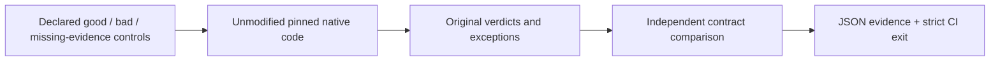

# EvalSentinel

[](https://github.com/bingdongni/evalsentinel/actions/workflows/ci.yml)

**Does your agent evaluator reject behavior it is supposed to reject?**

EvalSentinel runs offline, known-answer controls against **native evaluator code**.
Version 0.1 includes **30 named controls**, MCP pagination and OWASP approval
binding adapters, and explicit missing-evidence/error outcomes. No model API key,
GPU or real tool action is needed. [简体中文](README.zh-CN.md)

**Try without a local install:** [run the native demo in your fork](docs/try-it.md)
and [share a short trial report](https://github.com/bingdongni/evalsentinel/issues/new?template=trial-feedback.yml).

## Gate MCP production coverage in CI (v0.3 alpha)

For a local MCP 2026-07-28 test server, run the **unchanged native caching CLI**
and an explicit capability-aware policy. Undeclared optional endpoints do not
create production false alarms; declared broken endpoints still block. Native
verdicts remain intact. Wire-only or all-skipped evidence cannot earn a semantic
pass. Existing native reports can instead require named checks without a rerun.

```sh
evalsentinel check mcp --checkout /path/to/conformance --expected-commit FULL_40_HEX_SHA --url http://127.0.0.1:8765/mcp --contract production-caching-v1 --output-dir /path/to/new-report
```

Exit **0** passes the finite profile, **1** blocks on an in-scope violation, and
**2** means inconclusive evidence or an execution/source error. Empty resource
lists retain `resources/read: not_run`; this profile is not full MCP certification.
[Preparation, complete controls and CI integration](docs/mcp-production-gate.md).
This reproduces known upstream #516 behavior and complements work already in
progress there; it does not claim a new upstream defect.

## Check your OWASP evaluator commit in CI (v0.2+)

An OWASP assertion maintainer can select a clean PR commit and the explicit
single-use approval policy, then block a regression before merging:

```sh
evalsentinel check owasp --checkout /path/to/harness --expected-commit FULL_40_HEX_SHA --contract single-use-approval-v1 --output-dir /path/to/new-report
```

Exit **0** means agreement on 18 semantic controls and two executable guards;
**1** means a contract violation; **2** means an execution, compatibility or
source-verification error. Two unsupported evidence properties remain outside
the semantic denominator. The original native verdicts stay in the JSON report.

[Install and add the maintainer CI gate](docs/maintainer-gate.md). This works with
a caller-selected compatible commit, including future PRs, rather than requiring
one of our historical source pins. The supported native API and finite policy
are explicit; adoption by external maintainers remains unverified.

The gate is exercised against new native commits that deliberately overaccept,
overreject or crash. A controlled stale-bytecode experiment also checks that
current source changes cannot be hidden by old cached code. These are liveness
checks of the gate, not additional independent corpus cases or upstream defects.

## A real before/after control

The OWASP integration compares an unchanged native baseline with the proposed
single-use approval fix in upstream [PR #211](https://github.com/OWASP/Agent-Security-Regression-Harness/pull/211).
The issue and fix belong to their original author; this is independent regression
validation, not a new vulnerability discovery.

| Same 22 OWASP controls | Baseline | Proposed fix |
| --- | ---: | ---: |
| Known bad inputs incorrectly accepted | 6 | 0 |
| Valid controls accepted | 7 | 7 |
| Invalid behavior correctly rejected | 5 | 11 |
| Unexercised sensitive action | 1 | 1 |
| Properties unsupported by native evidence | 2 | 2 |
| Deliberate malformed-input error | 1 | 1 |

These are six counterexample inputs under a declared single-use policy, not six
independent vulnerabilities. The baseline explicitly documents a weaker MVP
policy. Event chronology and durable terminal state are not inferred from
separate trace lists. Errors and unsupported cases never count as catches.

## Try the Python-only OWASP path

Install Python 3.12+, Git and [uv](https://docs.astral.sh/uv/), then:

```sh
git clone https://github.com/bingdongni/evalsentinel.git
cd evalsentinel
uv sync --locked --no-dev
uv run --no-dev python tools/prepare_native.py --adapter owasp
uv run --offline --no-dev evalsentinel audit owasp --checkout .cache/owasp-fixed --revision candidate --require-sound --output-dir runs/fixed
```

Preparing sources/dependencies downloads public packages and code. Audit execution
uses local imports, and the OWASP worker denies Python socket connections.

To observe the negative control, run the baseline with the same strict gate:

```sh
uv run --offline --no-dev evalsentinel audit owasp --checkout .cache/owasp-harness --revision baseline --require-sound --output-dir runs/baseline
```

**The baseline command deliberately exits 1; the candidate exits 0.** This is a
real acceptance/rejection control, not a subprocess failure counted as a catch.
Use a fresh output directory for each invocation.

## Run the full 30-control matrix

For MCP, also install Node 22 and prepare its locked native dependencies:

```sh
uv run --no-dev python tools/prepare_native.py --adapter all
npm ci --prefix .cache/conformance --ignore-scripts --no-audit --no-fund
npm run --prefix .cache/conformance build
uv run --offline --no-dev evalsentinel audit all --mcp-checkout .cache/conformance --owasp-baseline .cache/owasp-harness --owasp-candidate .cache/owasp-fixed --output-dir runs/full
uv run --offline --no-dev python tools/verify_native_suite.py runs/full/report.json
```

The matrix is **8 MCP controls × 2 protocol versions + 22 OWASP controls × 2
revisions = 60 observation rows, from 30 unique controls**. The verification tool
also replays the real strict-mode negative and positive commands. Repeated
versions/revisions do not create new independent cases.

A default audit exits 0 when its *characterization expectations* match, including
known baseline false accepts. It does not certify that baseline as sound.
`--require-sound` additionally fails on adjudicable contract mismatches. The two
unsupported properties remain explicitly outside that gate.



Inspect [the fixture catalogue](docs/corpus.md), [a recorded report](examples/v0.1/report.json),
the [CLI contract](docs/cli-contract.md) and [v0.1 semantics](docs/v0.1-contract.md).
`evalsentinel cases` lists all 30; use `--adapter mcp` or `--adapter owasp` to filter.

## Contribute a useful regression

- [Report an integration need or reproducible failure](https://github.com/bingdongni/evalsentinel/issues/new/choose).
- [Pick an approachable task](https://github.com/bingdongni/evalsentinel/labels/good%20first%20issue).
- Read [CONTRIBUTING.md](CONTRIBUTING.md) before adding a fixture or adapter.

If this helps your evaluation work, a star makes the project easier to find.
Useful reports and well-sourced regressions are especially welcome. We do not
count maintainer-created issues or this release PR as outside adoption.

## Development and limits

```sh
uv sync --locked --group dev
uv run --offline ruff check src tests tools
uv run --offline ruff format --check src tests tools
uv run --offline ty check src
uv run --offline pytest
uv build
```

CI checks Windows and Linux, then runs the full native matrix and strict-mode
controls on both. Standard runners, read-only permissions and pinned Actions
are used. No model credentials, larger runners or automatic PyPI publishing.

MCP uses the proposed scenario in [conformance #583](https://github.com/modelcontextprotocol/conformance/pull/583),
based on [issue #577](https://github.com/modelcontextprotocol/conformance/issues/577).
The OWASP comparison uses the open fix for [issue #210](https://github.com/OWASP/Agent-Security-Regression-Harness/issues/210).
Neither pending PR is described as an already released upstream feature.
Native implementations are not bundled and keep their original licenses.

Prior work includes [evalmut](https://github.com/egnaro9/evalmut), the native
conformance/security harnesses, InfernoSIM and oracle-integrity auditing. This
release does not prove research novelty or superiority over those tools.
The value to validate is maintained stateful cases, direct native integrations
and low integration cost. [Project decision](decisions/001-project-selection.md).

MIT licensed. Implementation, documentation and verification were prepared with
Codex assistance. Full source pins and original verdicts are retained in reports;
source/build identity is recorded, not cryptographically attested.
